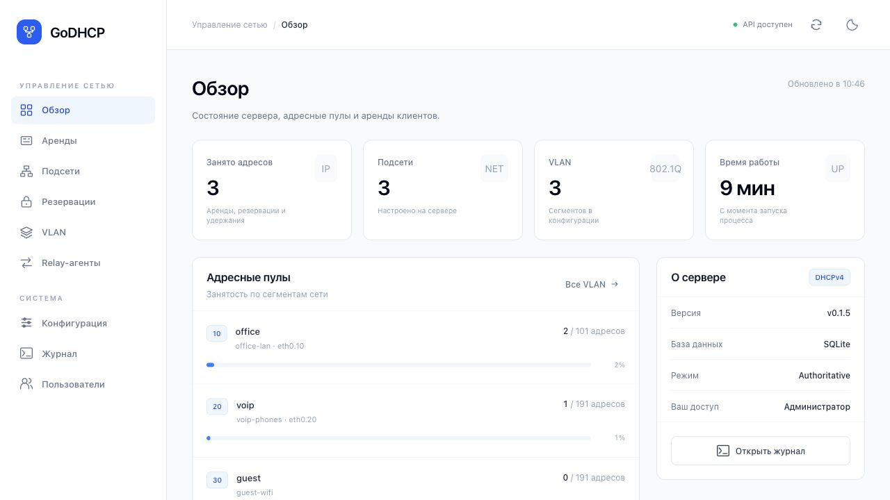
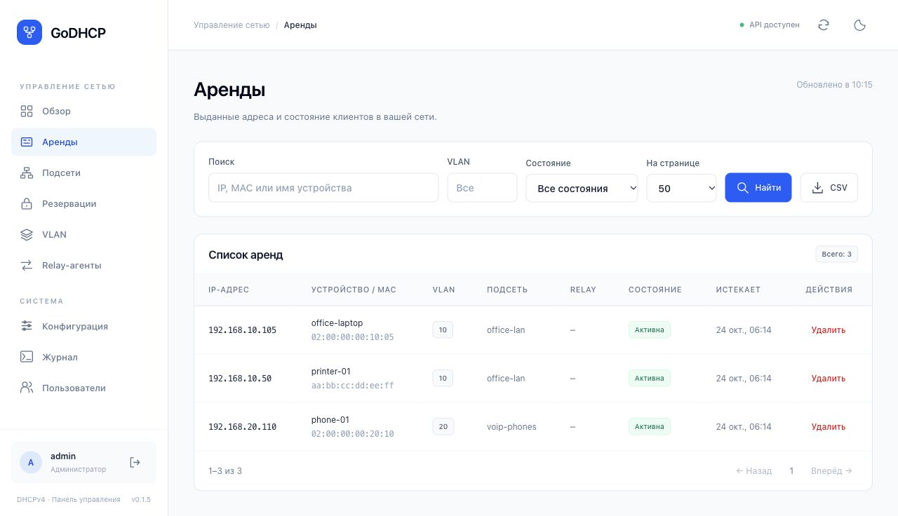

# GoDHCP

GoDHCP — DHCPv4/v6-сервер на Go для управления адресами в локальных сетях, VLAN и сетях за DHCP relay. Он объединяет выдачу аренд, резервации, защищённые обновления DNS, REST API и веб-панель в одном исполняемом файле.

Веб-интерфейс построен на Go `html/template`, JavaScript и Tailwind CSS. Шаблоны и готовая статика встроены в бинарник через `go:embed`. Для запуска сервера и панели достаточно бинарника и конфигурации YAML.

**Автор — Кислов Роман Сергеевич.** Контакт: [roman@kislovs.ru](mailto:roman@kislovs.ru). Лицензия — Apache 2.0.

[Скачать релиз](https://github.com/rkislov/gdhcp/releases/latest) · [Руководство по веб-интерфейсу](docs/web-guide.md) · [PDF со скриншотами](docs/godhcp-web-guide.pdf) · [Руководство администратора](docs/admin-guide.md)

## Скриншоты веб-интерфейса

Примеры из демонстрационного стенда.

### Обзор сервера и адресных пулов



### Аренды и поиск клиентов



## Возможности

- **DHCPv4** — DISCOVER, OFFER, REQUEST, ACK, NAK, DECLINE, RELEASE и INFORM, динамические пулы, резервации по MAC/client-id, authoritative-режим, ping-check и PXE.
- **DHCPv6** — выдача адресов IA_NA, DNS-опции и доверенный relay. Настройка описана в [руководстве DHCPv6](docs/dhcpv6.md).
- **VLAN** — выбор подсети по интерфейсу и VLAN ID, опция 43, PCP на Linux через SO_PRIORITY и egress-qos-map, управление VLAN-интерфейсами через netlink при `server.manage_links: true`.
- **DHCP relay** — опция 82 с эхо исходных данных, link-selection, доверенные relay, исключения по giaddr, лимит hops, встроенные и пользовательские regex-парсеры Circuit ID.
- **Хранилище** — SQLite по умолчанию, PostgreSQL как альтернатива, персистентные аренды и транзакционное выделение адресов.
- **Конфигурация** — YAML, переменные окружения, проверка настроек и hot-reload. Импорт подсетей и фиксированных записей из ISC `dhcpd.conf`, включая вложенные `include`.
- **Управление** — веб-панель для аренд, подсетей, резерваций, VLAN, relay, YAML и журналов, REST API и Swagger.
- **Доступ** — JWT, API-ключи, роли `admin`, `operator`, `viewer`, LDAP и ограничения доступа по VLAN.
- **DDNS** — A/PTR через Kerberos/GSS-TSIG для Samba AD или TSIG, принятие существующих записей по настройке `ddns.adopt_existing`, очистка управляемых записей. Сверка обрабатывает до восьми клиентов параллельно.
- **Наблюдаемость** — Prometheus, структурированные логи, поток журнала через SSE, `/healthz`, `/readyz`, правило logrotate в Linux-пакетах.

## Резервирование

Начиная с v0.1.15 доступен **экспериментальный автоматический кластер** из трёх Raft-реплик с mTLS, одним активным DHCP/API/DDNS, переносом service IP и fencing-адаптерами для Proxmox, VMware, Hyper-V, KVM, IPMI и Redfish.

Перед внедрением изучите [порядок запуска и ограничения кластера](docs/cluster-runtime.md). Автоматического переноса действующих аренд из SQLite/PostgreSQL в Raft пока нет. Отдельный режим `ha` распределяет новых клиентов по хэшу RFC 3074 и имеет собственные ограничения, описанные в [руководстве по резервированию](docs/clustering.md).

## Установка

[Обновление до v0.1.18 с сохранением настроек, аренд и DDNS](docs/upgrade-v0.1.18.md).

Основная платформа — Linux. В релизах также доступны бинарники для Raspberry Pi и macOS. Набор пакетов и архитектур указан в приложениях и описании конкретного релиза.

- [Все релизы и контрольные суммы](https://github.com/rkislov/gdhcp/releases).
- [ALT Linux p10](docs/altlinux-p10.md).
- [ALT Linux p11 и доступные архитектуры](docs/altlinux-p11.md).
- [Astra Linux и РЕД ОС](docs/astra-redos.md).
- [Ubuntu и CentOS Stream 9 — пакеты и инструкция в v0.1.14](https://github.com/rkislov/gdhcp/releases/tag/v0.1.14).

Linux-пакеты устанавливают службу systemd, пример конфигурации, logrotate и PDF-руководства. Перед первым запуском подготовьте `/etc/godhcp/config.yml` и `/etc/godhcp/godhcp.env` по [инструкции администратора](docs/admin-guide.md).

### Стандартный порт DHCP

**DHCPv4 по умолчанию слушает UDP-порт 67** (`server.listen: ":67"`). Убедитесь, что порт свободен, а конфигурация соответствует обслуживаемым сетям. DHCPv6 при включении использует стандартный UDP-порт 547.

На Linux привязка к привилегированному порту требует root или `CAP_NET_BIND_SERVICE`. Для ping-check и управления VLAN нужны дополнительные `CAP_NET_RAW` и `CAP_NET_ADMIN` соответственно. Пакетная служба запускается от пользователя `godhcp` с `CAP_NET_BIND_SERVICE`; дополнительные возможности требуют настройки прав службы.

Нестандартный порт подходит для тестов. Обычные DHCP-клиенты и relay обращаются к стандартным портам.

## Сборка и первый запуск

Для сборки нужен Go 1.26+. Готовая статика уже хранится в исходниках.

```bash
git clone https://github.com/rkislov/gdhcp.git
cd gdhcp
make build
./bin/godhcp -validate -config configs/example.yml
```

Для изолированного стенда отредактируйте `configs/dev.yml` под свои интерфейсы, подсети и адрес сервера, затем запустите:

```bash
sudo ./bin/godhcp -config configs/dev.yml
```

В примере панель доступна по адресу <http://127.0.0.1:8181/ui/>, Swagger — <http://127.0.0.1:8181/swagger>, метрики — на порту 9090. Учётные данные стенда — `admin` / `changeme`. Перед рабочим использованием смените пароль, JWT secret и настройте TLS и доступ к API.

Для изменения CSS нужны `npm ci` и `npm run build:css`.

### Импорт ISC DHCP

```bash
./bin/godhcp import-dhcpd -in /etc/dhcp/dhcpd.conf -out ./imported-config.yml
./bin/godhcp -validate -config ./imported-config.yml
```

Проверьте импортированные настройки перед применением к серверу. Подробности и повторный импорт описаны в [руководстве импорта](docs/import-dhcpd.md).

Конфигурация перечитывается по `SIGHUP`, через `POST /api/v1/config/reload` или командой `systemctl reload godhcp` для пакетной службы.

## Docker

```bash
docker build -f deploy/Dockerfile -t godhcp:local .
docker run -d --name godhcp \
  --network host \
  --cap-add=NET_ADMIN --cap-add=NET_RAW \
  -v /etc/godhcp:/etc/godhcp \
  -v /var/lib/godhcp:/var/lib/godhcp \
  godhcp:local
```

Пример рассчитан на Linux-хост с подготовленной конфигурацией. Distroless-образ запускает процесс от root. Для DDNS нужны внешние программы `nsupdate`, `kinit` и, при проверке Samba RPC, `samba-tool`; их подготовка описана в [руководстве DDNS](docs/ddns-samba.md).

## Документация

- [Панель управления — пошаговое руководство](docs/web-guide.md), [PDF со скриншотами](docs/godhcp-web-guide.pdf).
- [Руководство администратора](docs/admin-guide.md), [PDF](docs/godhcp-admin-guide.pdf).
- [Справочник YAML](docs/configuration.md), [REST API](docs/api.md), [права и LDAP](docs/access-control.md).
- [VLAN](docs/vlans.md), [relay](docs/relay.md), [форматы Circuit ID](docs/relay-vendors.md).
- [DHCPv6](docs/dhcpv6.md), [Samba AD DDNS и обратные зоны для /22](docs/ddns-samba.md).
- [Архитектура](docs/architecture.md), [резервирование](docs/clustering.md), [экспериментальный кластер](docs/cluster-runtime.md), [fencing](docs/fencing.md), [проект кластера](docs/clustering-design.md).
- [Импорт dhcpd.conf](docs/import-dhcpd.md), [диагностика](docs/troubleshooting.md), [производительность и ограничения](docs/performance.md).
- [Сборка пакетов и PDF](docs/building.md), [лицензии зависимостей](docs/license.md), [man-страница godhcp(8)](docs/godhcp.8).

Примеры конфигураций находятся в `configs/` — office, ISP, VoIP, guest Wi-Fi и PXE.

## Проверки

```bash
go test ./...
go test -race ./...
go vet ./...
npm run test:ui
```

`make test-dhcp-docker` проверяет DHCPv4, VLAN, relay и восстановление SQLite в изолированной сети. `make test-dhcpv6-docker` проверяет DHCPv6. `bash scripts/test-ddns-samba.sh` проверяет DDNS на одноразовом Samba AD. Для нагрузочных испытаний используется `make test-load-docker`, для проверки службы с перезагрузкой гостевой ОС — `make test-systemd-vm`.

Результаты измерений и границы проверенной совместимости приведены в [отчёте о производительности](docs/performance.md) и документации соответствующих пакетов.

## Участие в проекте

<!-- owner-maintenance:start -->
**Автор проекта, изменений и публикаций — Кислов Роман Сергеевич ([@rkislov](https://github.com/rkislov)).**

Ошибки и предложения принимаются через **Issues**, изменения — через **Pull Requests** из форков. Прямую запись в основной репозиторий и публикацию версий выполняет только владелец `rkislov`.
<!-- owner-maintenance:end -->

## Лицензия

Apache License, Version 2.0. © 2026 Кислов Роман Сергеевич.

Полный текст — [LICENSE](LICENSE), уведомление об авторстве — [NOTICE](NOTICE), сторонние компоненты — [THIRD_PARTY_LICENSES](THIRD_PARTY_LICENSES).

Программа распространяется «AS IS» в соответствии с Apache License 2.0.

Два узла: [active/backup с mTLS и fencing, прошедший приёмку](docs/active-backup.md) (с v0.1.18).

Подробная настройка пары и трёхузлового кластера: [пошаговая эксплуатационная инструкция](docs/cluster-operations.md).
