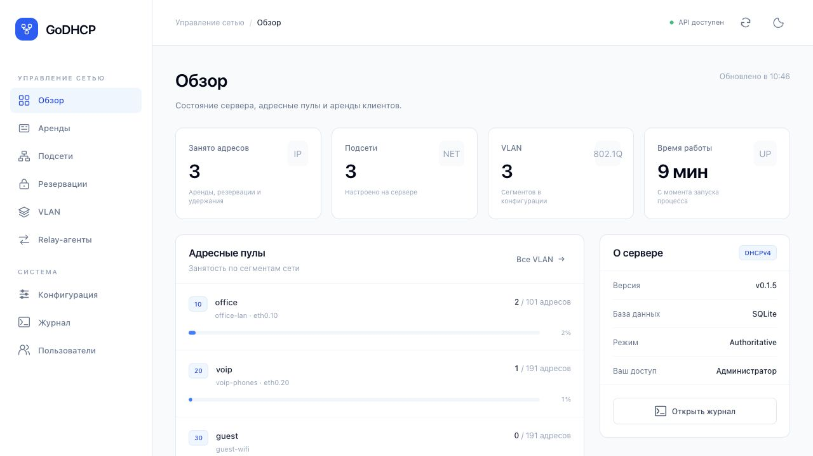
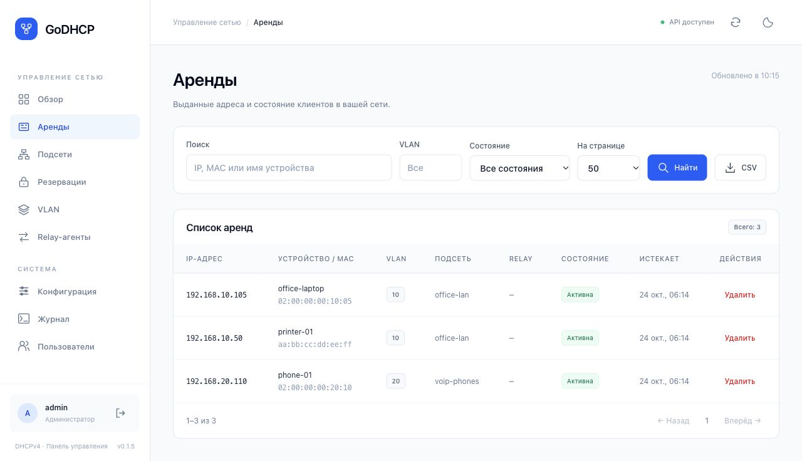
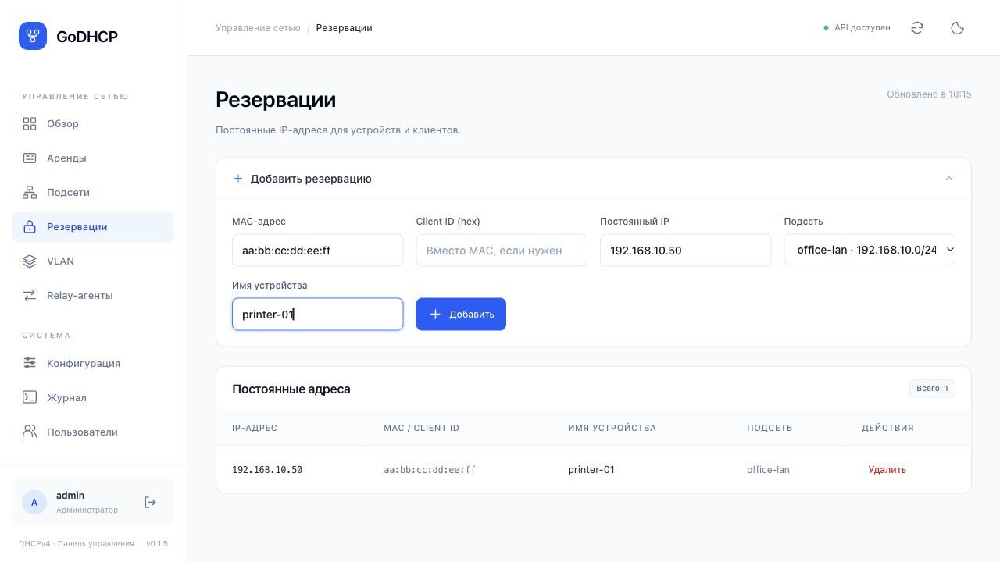
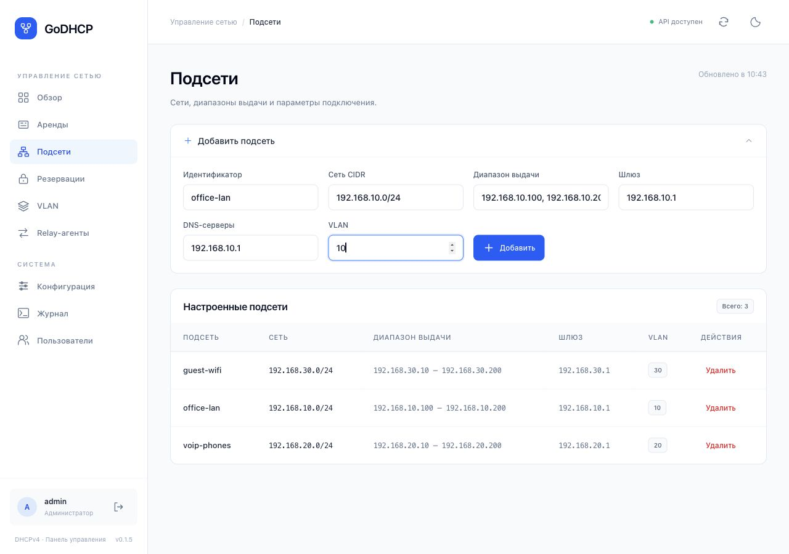
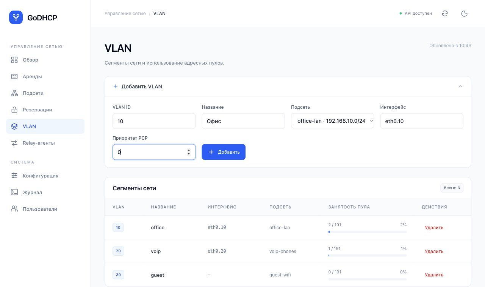
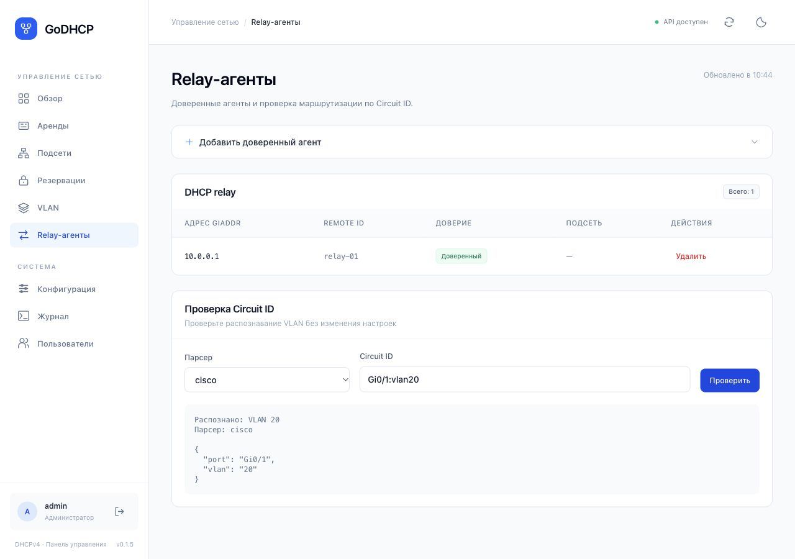
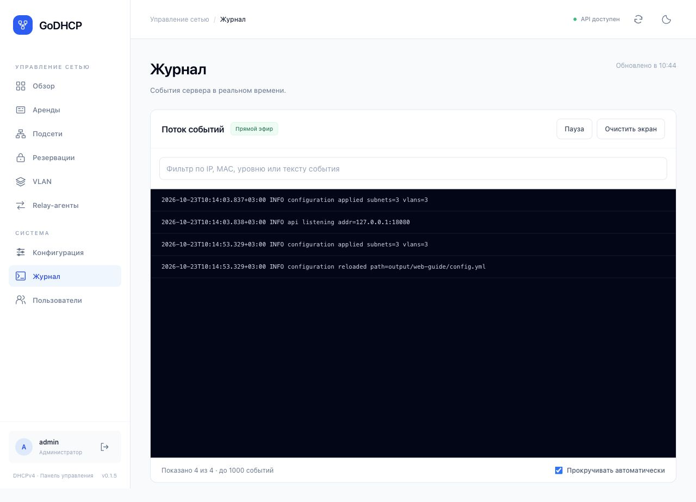
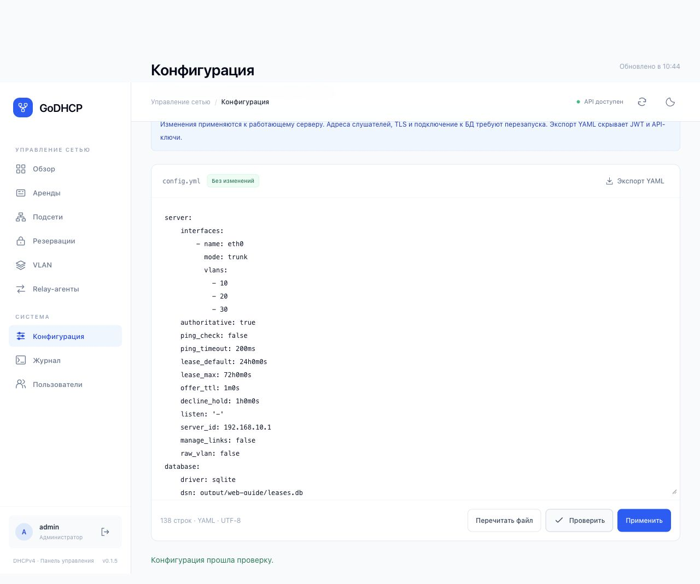

# GoDHCP: работа через веб-интерфейс для начинающего администратора

© 2026 Кислов Роман Сергеевич. Apache License 2.0.

Скриншоты сняты на отдельном демонстрационном сервере. Имена устройств, IP и MAC на них - примеры. Заполненные формы иллюстрируют ввод: не добавляйте повторно подсеть или резервацию, уже видимую в таблице. Вид бокового меню зависит от ширины окна.

Инструкция соответствует интерфейсу GoDHCP v0.1.10. В ней используются названия полей и кнопок, которые есть в программе. Примеры адресов не нужно переносить в рабочую сеть без проверки.

В версии 0.1.9 нет автоматического входа как `anonymous`: требуется настроенный пользователь. Если администратор ещё не создан, добавьте его в YAML по [инструкции обновления](upgrade-v0.1.9.md). Сохранённая действующая сессия остаётся доступной; для проверки формы входа используйте приватное окно. Общий порт API и веб-интерфейса по умолчанию - 8181.

## 1. Что должно быть готово до входа

Попросите сотрудника, который установил сервер, передать вам:

- адрес панели, например `https://dhcp.company.local/ui/`;
- ваше имя пользователя и пароль;
- название вашей подсети, например `office-lan`;
- адрес шлюза и DNS, разрешённый диапазон выдачи адресов;
- номер VLAN, только если он действительно используется;
- контакт человека, который обслуживает коммутатор и сервер Linux.

DHCP автоматически выдаёт устройствам IP-адреса. Подсеть — группа адресов одной сети. Пул — часть этих адресов, которую сервер может выдавать. Аренда — временное закрепление адреса. Резервация — постоянное закрепление за конкретным устройством. MAC — адрес сетевого адаптера устройства.

**Панель управления и выдача адресов — разные службы.** То, что открылась страница, ещё не доказывает, что клиенты получают адреса. Порт DHCP — UDP 67; его запуск и права настраивает установивший сервер сотрудник. В примере для установки Linux-пакета DHCP изначально выключен (`server.listen: "-"`), а панель доступна только с самого сервера. В браузере вы это автоматически не исправите: нужен подготовленный сервер или адрес, выданный установщиком.

Перед заменой старого DHCP согласуйте переключение. Не запускайте два независимых DHCP-сервера в одной сети без заранее спроектированной схемы.

## 2. Как войти

1. Откройте выданный адрес панели.
2. В поле **«Имя пользователя»** введите свою учётную запись.
3. В поле **«Пароль»** введите пароль. Значок глаза позволяет проверить введённые символы.
4. **«Запомнить вход на этом устройстве»** включайте только на личном рабочем компьютере.
5. Нажмите **«Войти в панель»**.

**Проверка:** открылась страница **«Обзор»**, внизу левого меню видны имя пользователя и роль, справа вверху есть состояние соединения с API.

Пароль `changeme` относится к демонстрационным конфигурациям `configs/dev.yml` и `configs/example.yml`. У установленного Linux-пакета нет универсального пароля: данные задаются при установке.

Если вход не работает, проверьте раскладку, Caps Lock и адрес панели. Не создавайте новый сервер и не редактируйте файл паролей наугад.


Рисунок 1. Вход: имя пользователя, пароль и кнопка входа.

## 3. Что означают права доступа

- **Наблюдатель / viewer:** смотрит состояние сервера и аренды. Кнопки изменения могут быть скрыты.
- **Оператор / operator:** дополнительно управляет резервациями и арендой, проверяет Circuit ID.
- **Администратор / admin:** настраивает подсети, VLAN, relay, пользователей и конфигурацию.

Если нет нужной кнопки, сначала проверьте роль. Это не обязательно ошибка программы.

На узком экране меню открывается кнопкой с тремя полосками. Кнопка **«Обновить данные»** в верхней панели перечитывает страницу. Кнопка **«Сменить тему»** меняет только внешний вид.

## 4. Ежедневная проверка: работает ли сервер

1. Откройте **«Обзор»**.
2. Убедитесь, что панель соединена с API.
3. Посмотрите число активных аренд и заполнение пулов VLAN.
4. Откройте **«Аренды»** и найдите известный рабочий компьютер по IP, MAC или имени.
5. Нажмите **«Найти»**. Проверьте подсеть и состояние **«Активна»**.

**Проверка:** устройство есть в ожидаемой подсети, его адрес соответствует нужной сети. Значение **«Истекает»** — конец текущего срока аренды, а не время выключения устройства.

Состояния:

- **«Активна» / bound:** адрес выдан клиенту.
- **«Предложена» / offered:** сервер предложил адрес, клиент ещё не завершил получение.
- **«Конфликт IP» / declined:** клиент сообщил, что адрес уже занят. Не освобождайте его вручную, пока не выяснена причина.
- **«Освобождена» / released:** клиент отказался от аренды.
- **«Истекла» / expired:** срок закончился.

Пустой список сразу после запуска может быть нормальным: клиенты ещё не запрашивали адрес. Но отсутствие аренд после подключения нового тестового клиента требует проверки сети и журнала.



Рисунок 2. Обзор: состояние API и заполнение пулов.

## 5. Найти устройство и сохранить список

1. Перейдите в **«Аренды»**.
2. В **«Поиск»** введите IP, MAC или имя устройства.
3. При необходимости заполните **«VLAN»** и выберите **«Состояние»**.
4. Нажмите **«Найти»**.
5. Для просмотра следующих записей используйте **«Вперёд →»**, **«← Назад»** и **«На странице»**.
6. Кнопка **«CSV»** скачивает записи **текущей страницы**, а не все аренды сервера.

**Не удаляйте аренду просто для «перезагрузки интернета».** Удаление в панели не заставляет устройство немедленно забыть адрес. Оно может продолжать им пользоваться, пока сервер уже считает адрес свободным. Для закрепления IP используйте резервацию.



Рисунок 3. Аренды: поиск устройства, фильтры и экспорт CSV.

## 6. Закрепить IP за принтером или другим устройством

Пример: принтер должен всегда получать `192.168.10.50` в подсети `office-lan`.

Сначала выясните MAC принтера. Его можно посмотреть в текущей аренде или сетевых настройках принтера. Адрес `.50` должен быть свободным и входить в подсеть, но желательно находиться вне динамического диапазона, например `.100`–`.200`. Не занимайте IP шлюза, сервера или другого устройства.

1. Откройте **«Резервации»**.
2. Разверните **«Добавить резервацию»**.
3. Заполните **«MAC-адрес»**, например `aa:bb:cc:dd:ee:ff`. Вставьте настоящий адрес своего устройства.
4. **«Client ID (hex)»** оставьте пустым. Его используют вместо MAC только когда известен правильный DHCP Client ID.
5. В **«Постоянный IP»** введите `192.168.10.50`.
6. В **«Подсеть»** выберите `office-lan`.
7. В **«Имя устройства»** введите `printer-01`.
8. Нажмите **«Добавить»**.

**Проверка:** новая запись появилась в таблице **«Постоянные адреса»**. Это означает, что правило сохранено; принтер ещё может работать со старой арендой.

В согласованное время выполните обновление адреса в сетевом меню принтера либо перезапустите только принтер. Затем найдите его MAC в **«Аренды»** и проверьте новый адрес. Сам принтер должен получать адрес автоматически, по DHCP, а не иметь вручную установленный IP.

У ноутбука Wi-Fi может использовать случайный/частный MAC. Для резервации нужен MAC, который устройство действительно использует в этой сети.



Рисунок 4. Пример заполненной резервации принтера; существующая запись видна ниже.

## 7. Добавить подсеть

Эта операция нужна только при добавлении новой сети. Если нужная подсеть уже есть, повторно создавать её не нужно.

Пример параметров, **заранее согласованных с ответственным за сеть**:

- сеть `192.168.10.0/24`;
- шлюз `192.168.10.1`;
- сам сервер GoDHCP `192.168.10.2`;
- выдаваемые адреса `192.168.10.100`–`192.168.10.200`;
- DNS `192.168.10.1`, если маршрутизатор действительно предоставляет DNS;
- VLAN `10`, если он настроен на оборудовании.

Шлюз и сервер GoDHCP могут иметь разные адреса. `/24` в этом примере соответствует маске `255.255.255.0`; это не правило для всех сетей.

1. Перейдите в **«Подсети»**.
2. Разверните **«Добавить подсеть»**.
3. **«Идентификатор»**: `office-lan`. Это короткое служебное имя без пробелов.
4. **«Сеть CIDR»**: `192.168.10.0/24` — адрес сети, не адрес сервера.
5. **«Диапазон выдачи»**: `192.168.10.100, 192.168.10.200`. Два адреса разделяются **запятой**.
6. **«Шлюз»**: `192.168.10.1`.
7. **«DNS-серверы»**: согласованные адреса, через запятую, если их несколько.
8. **«VLAN»**: `10` только если он нужен в подготовленной сети; иначе оставьте пустым.
9. Нажмите **«Добавить»**.

**Проверка:** подсеть появилась в таблице, сеть, диапазон, шлюз и VLAN совпадают с согласованными значениями. Подключите один тестовый клиент и проверьте его аренду и доступ к шлюзу.

Создание записи в панели не подключает кабели, не настраивает маршрутизатор и не создаёт сетевой интерфейс ОС для этой подсети. Это должен подготовить установщик. В текущей таблице нет кнопки редактирования существующей подсети: изменение её полей выполняется администратором через **«Конфигурация»** или REST API. Не удаляйте рабочую подсеть ради её пересоздания.



Рисунок 5. Пример полей подсети: диапазон вводится через запятую.

## 8. VLAN: когда нужно и как добавить

VLAN разделяет одну физическую сеть на логические сегменты. Если у вас обычная плоская сеть и ответственным за сеть VLAN не назначен, не придумывайте номер самостоятельно.

Перед добавлением должны быть готовы порт коммутатора, VLAN-интерфейс Linux и подсеть. Пример: уже создана `office-lan`, согласован VLAN 10, интерфейс сервера называется `eth0.10`.

1. Откройте **«VLAN»** → **«Добавить VLAN»**.
2. **«VLAN ID»**: `10`.
3. **«Название»**: `Офис`.
4. **«Подсеть»**: `office-lan`.
5. **«Интерфейс»**: точное имя, переданное установщиком, например `eth0.10`.
6. **«Приоритет PCP»**: обычно `0`. Для телефонии `6` ставят только по согласованной схеме QoS.
7. Нажмите **«Добавить»**.

**Проверка:** запись появилась, выбран правильный интерфейс и подсеть. Тестовый клиент именно в этом VLAN получил адрес из ожидаемого пула.

Просто ввести PCP=6 недостаточно. На Linux нужна egress-qos-map, которую отдельно настраивает сотрудник с доступом к ОС. Веб-панель не проверяет коммутатор и не гарантирует доставку PCP до телефона. На macOS передача PCP этим способом не поддерживается.



Рисунок 6. VLAN связывается с готовой подсетью и интерфейсом ОС.

## 9. Relay: клиенты находятся за маршрутизатором

Relay — агент на маршрутизаторе, который пересылает DHCP-запросы серверу. Он нужен, если клиентская сеть и сервер находятся в разных сетях. Если клиенты подключены напрямую, этот раздел обычно не нужен.

Попросите сетевого специалиста сообщить **giaddr**, **Remote ID** и подсеть клиентов. giaddr — адрес, который агент ставит в DHCP-запросе; это не обязательно адрес самого сервера или интерфейса маршрутизатора в сторону сервера.

1. Откройте **«Relay-агенты»** → **«Добавить доверенный агент»**.
2. В **«Адрес giaddr»** введите согласованное значение, например `10.0.0.1`.
3. В **«Remote ID»** введите точное значение от оборудования, например `relay-01`. Если агент его не передаёт, поле оставляют пустым по согласованной настройке.
4. В **«Подсеть»** выберите клиентскую подсеть.
5. Нажмите **«Доверить»**.

**Проверка:** агент появился в таблице с нужной подсетью. Клиент за маршрутизатором получил адрес из неё, а в его аренде заполнена колонка **«Relay»**.

Добавление агента в панели не включает DHCP relay на маршрутизаторе и не открывает UDP 67 в межсетевом экране.

### Проверить Circuit ID

1. В разделе **«Проверка Circuit ID»** выберите **«Парсер»**, например `cisco`.
2. Введите настоящую строку агента или учебный пример `Gi0/1:vlan20`.
3. Нажмите **«Проверить»**.
4. В результате `ok: true` и `vlan: 20` означают, что строка распознана как VLAN 20.

Этот тест не посылает запрос на маршрутизатор и не выдаёт IP. Даже успешный разбор не подтверждает, что VLAN 20, подсеть и сетевой путь настроены правильно. Не подставляйте учебную строку в рабочие настройки оборудования.



Рисунок 7. Проверка Circuit ID: строка Gi0/1:vlan20 распознана как VLAN 20.

## 10. Журнал: что делать, если адрес не выдан

1. Запишите MAC проблемного клиента и время попытки.
2. Откройте **«Журнал»**. Новые события появляются автоматически.
3. Используйте поиск по MAC или IP. Если строк слишком много, включите **«Пауза»**.
4. Сохраните или скопируйте относящиеся к клиенту сообщения для ответственного за сеть.

Типичные сообщения:

- `no subnet for request` — запрос не удалось сопоставить с подсетью; проверьте VLAN, интерфейс и привязку relay.
- `pool exhausted` — доступные адреса закончились. Не расширяйте диапазон за пределы согласованной сети.
- `dropped untrusted relay` — giaddr или Remote ID не совпали с доверенной записью.
- `hops exceeded` — превышен допустимый путь через relay; требуется проверка маршрутизаторов.
- `persist lease` или ошибка БД — сервер не смог сохранить аренду. Не удаляйте файл SQLite; передайте сообщение обслуживающему сервер сотруднику.

Не все события видны при любом уровне журналирования. Отсутствие обычных сообщений при `logging.level: error` не означает отсутствия запросов.



Рисунок 8. Журнал: события сервера, фильтр и управление прокруткой.

## 11. Конфигурация: экспорт, проверка и применение

Раздел доступен администратору. Для повседневной работы предпочитайте обычные формы. Не меняйте YAML, если не уверены, какой раздел редактируете.

### Сохранить копию перед изменением

1. Откройте **«Конфигурация»**.
2. Нажмите **«Экспорт YAML»** и сохраните файл с понятной датой.
3. Храните его в доступном только администраторам месте: он может содержать хеши паролей.

JWT, API-ключи и пароль LDAP-службы заменены на `***`. Это полезный снимок настроек, но не полная резервная копия: для восстановления сервера нужны также его секреты и корректная резервная копия БД. Их сохраняет сотрудник с доступом к серверу.

### Применить согласованное изменение

1. Меняйте только согласованный раздел. В YAML важны отступы; не используйте табуляцию.
2. Не заменяйте скрытые `***` случайным текстом и не удаляйте учётные записи.
3. Нажмите **«Проверить»**. Дождитесь сообщения **«Конфигурация прошла проверку.»**
4. Нажмите **«Применить»** и подтвердите действие.
5. Проверьте результат обычной формой и одним тестовым клиентом.

**«Проверить»** ещё ничего не применяет. Проверка синтаксиса не доказывает, что шлюз существует или коммутатор правильно настроен.

**«Перечитать файл»** загружает настройки с диска сервера, а не применяет текст редактора; несохранённые правки в редакторе могут быть потеряны. Для отмены несохранённого текста проще уйти со страницы и открыть её заново.

Параметры адресов слушателей, TLS и подключения к БД требуют перезапуска процесса. Кнопка **«Применить»** такой перезапуск не выполняет. Это работа установщика сервера.



Рисунок 9. Проверка YAML выполнена; применение выполняется отдельной кнопкой.

## 12. Пользователи и завершение работы

В **«Пользователи»** глобальный администратор создаёт и изменяет учётные записи, назначает группы и область VLAN, настраивает LDAP. Подробный порядок приведён в разделе «LDAP, роли и делегирование VLAN» ниже. Для обычной работы выдавайте operator или viewer, если административные права не нужны.

Не удаляйте последнего работающего администратора. Перед заменой учётной записи сначала создайте новую, проверьте вход в отдельном окне браузера и только потом решайте вопрос со старой.

После работы нажмите кнопку **«Выйти»** внизу левого меню. Закрытие вкладки само по себе не равно выходу, особенно если был включён пункт «Запомнить вход».

## 13. Быстрая памятка при проблеме

- Страница не открывается: проверьте выданный URL и соединение с сетью; сообщите установщику адрес и текст ошибки браузера.
- Войти удалось, но кнопок нет: проверьте роль пользователя.
- Кнопка выдаёт ошибку: прочитайте её целиком; не нажимайте многократно и не удаляйте существующие записи наугад.
- Резервация есть, а IP старый: проверьте MAC и настройку DHCP на устройстве, дождитесь продления или обновите адрес в согласованное время.
- Аренда активна, а интернета нет: проверьте шлюз, DNS и работу маршрутизатора. DHCP выдаёт параметры сети, но не предоставляет интернет сам.
- Клиент получает `169.254.x.x`: получение адреса по DHCP, вероятно, не завершилось. Запишите MAC, время и найдите события в журнале.

Для обращения за помощью передайте: время, MAC устройства, ожидаемую подсеть/VLAN, полученный IP, текст ошибки и относящиеся к клиенту сообщения журнала. Пароли и секреты отправлять не нужно.

## 14. Обновление сервера и повторный импорт из dhcpd

Полная [пошаговая инструкция по обновлению](upgrade-v0.1.8.md) описывает резервную копию настроек и базы, установку пакета, повторный импорт, перенос резерваций, проверку через панель и откат. Обновление выполняется на сервере; браузер не устанавливает бинарник. В PDF этот раздел включён полностью.

<!-- include: upgrade-v0.1.9.md -->

## Файловые журналы и ротация

Страница «Журнал» показывает буфер последних событий в памяти. Для постоянного журнала администратор настраивает `logging.output`, права каталога и logrotate по [основной инструкции](admin-guide.md#запись-журналов-в-файл-и-logrotate). В архив и пакеты включён пример `docs/examples/godhcp.logrotate`. Изменение logging требует перезапуска; reload файл не переоткрывает. Для этой версии используется copytruncate с описанным в инструкции окном возможной потери строк.


## LDAP, роли и делегирование VLAN


### Настройка через веб

Войдите локальным глобальным администратором и откройте **Пользователи**.

1. В блоке **Группы доступа** создайте группу, выберите роль и область «Выбранные VLAN», отметьте нужные VLAN. Поле LDAP DN оставьте пустым для локальной группы либо укажите полный DN группы AD/FreeIPA.
2. Создайте локального пользователя или нажмите «Изменить» у существующего. Можно назначить прямую роль для выбранных VLAN или выбрать «Только права групп» и отметить группы доступа. При изменении пустой пароль сохраняет текущий пароль; новый пароль — минимум 8 символов.
3. Для полного управления выберите роль «Администратор» и область **Весь сервер**. Сохраняйте хотя бы одного локального глобального администратора для аварийного входа.
4. В блоке **LDAP** задайте адрес, Base DN, Bind DN и пароль служебной учётной записи. Шаблон «Microsoft Active Directory» подставляет фильтр `(&(objectClass=user)(sAMAccountName={username}))`, FreeIPA — `(&(objectClass=person)(uid={username}))`. Вход выполняется коротким именем, используемым выбранным фильтром.
5. Используйте `ldaps://dc.example.org:636` либо `ldap://dc.example.org:389` с включённым StartTLS. Для внутреннего центра сертификации укажите абсолютный путь к PEM-файлу CA на сервере, например `/etc/godhcp/ldap-ca.pem`; файл должен читаться пользователем службы. Имя сервера должно совпадать с сертификатом. Проверка сертификатов обязательна.
6. Отметьте «Включить вход через LDAP», введите существующего пользователя для проверки и нажмите «Проверить соединение и поиск». Это проверяет TLS, служебный bind и уникальность результата поиска; пароль самого пользователя проверяется при настоящем входе. Затем сохраните LDAP.
7. Сопоставьте группы с DN из результата проверки. Войдите в отдельном окне браузера тестовым пользователем и проверьте доступ к назначенным VLAN.

Сохранение через веб обновляет активную конфигурацию и YAML-файл, указанный при запуске; перезапуск не нужен. Для постоянного сохранения службе нужны права на каталог конфигурации. Если файл не удалось сохранить, API возвращает ошибку и восстанавливает предыдущую активную конфигурацию. При запуске без пути конфигурации изменения существуют только в памяти. Пароль служебного LDAP-пользователя хранится в конфигурации и скрывается как `***` в веб-ответах и экспорте. При сохранении `***` прежнее значение сохраняется.

### Роли и ограничения

- **Администратор**: в глобальной области — настройки сервера, пользователи, группы, LDAP, парсеры и все сетевые объекты; в области VLAN — свои VLAN, подсети, аренды и резервации.
- **Оператор**: аренды, резервации и диагностика в назначенной области.
- **Наблюдатель**: чтение в назначенной области.

Права групп складываются отдельно для каждого VLAN: администратор VLAN 10 и наблюдатель VLAN 20 не получает права изменения VLAN 20. Прямая роль пользователя также добавляется к групповым правам; для доступа исключительно через группы выберите «Только права групп».

Пустой список `vlan_ids` у роли или группы означает глобальную область. Выбор «Выбранные VLAN» в веб требует хотя бы одного VLAN. Разрешения можно подготовить для VLAN, который ещё не создан, через YAML; веб показывает настроенные VLAN.

Сервер проверяет доступ к отдельным объектам и фильтрует списки, счётчики и аренды до SQL-пагинации. Изолированный администратор VLAN не получает общий YAML, настройки доступа, журналы всего сервера, общие метрики или управление доверенными relay и парсерами. Интерфейсы Linux, PCP и правила сопоставления пакетов в VLAN настраивает глобальный администратор. Для общей подсети, связанной с несколькими VLAN, требуются права на все связанные VLAN; подсеть без принадлежности к VLAN доступна глобальным ролям.

При удалении локального пользователя старые access/refresh JWT перестают приниматься на следующий запрос. Назначения ролей и групп проверяются по текущей конфигурации, включая старые access JWT. При смене пароля уже выданные JWT сохраняются до истечения срока; для немедленного отзыва всех сеансов смените `jwt_secret`.

LDAP работает через служебный поиск пользователя и bind найденного DN с введённым паролем. Пустой пароль отвергается. Группы берутся из `memberOf` (или другого настроенного атрибута), сравниваются по DN без учёта регистра. Вложенные группы и primaryGroup AD автоматически не раскрываются. Назначайте прямое членство в группах доступа. Пользователь без сопоставленных прав не допускается. Локальное имя имеет приоритет: ошибочный локальный пароль не приводит к попытке LDAP с тем же именем.

Членство LDAP-групп обновляется при входе и refresh; между ними действует подписанный снимок членства до окончания access JWT (`token_ttl`, по умолчанию 1 час). Изменения локальных сопоставлений LDAP-групп действуют на следующий запрос. При недоступном каталоге новые LDAP-входы и refresh отклоняются, локальный вход продолжает работать. Это LDAP-аутентификация по паролю, не Kerberos/SSO.

### Пример YAML

```yaml
api:
  auth:
    jwt_secret: "${JWT_SECRET}"
    token_ttl: 15m
    refresh_ttl: 24h
    ldap:
      enabled: true
      url: ldaps://dc.example.org:636
      start_tls: false
      ca_file: /etc/godhcp/ldap-ca.pem
      bind_dn: CN=svc-dhcp,OU=Service,DC=example,DC=org
      bind_password: "${LDAP_BIND_PASSWORD}"
      base_dn: DC=example,DC=org
      user_filter: '(&(objectClass=user)(sAMAccountName={username}))'
      group_attribute: memberOf
      timeout_seconds: 5
    groups:
      - name: dhcp-vlan120-admins
        role: admin
        vlan_ids: [120]
        ldap_dn: CN=DHCP-VLAN120,OU=Groups,DC=example,DC=org
    users:
      - username: emergency-admin
        password_hash: "<argon2id hash from godhcp hash-password>"
        role: admin
      - username: local-operator
        password_hash: "<argon2id hash>"
        role: ""
        groups: [dhcp-vlan120-admins]
```

Это фрагмент, который нужно объединить со своей конфигурацией. Редактирование через веб сохраняет уже раскрытые значения переменных окружения в YAML; ограничьте права файла. Ключи API также поддерживают `vlan_ids`, настройка ключей выполняется через глобальный YAML.

Проверки реализации: автоматические тесты TLS LDAP (LDAPS и StartTLS), проверка CA, служебный и пользовательский bind, неверный/пустой пароль, неоднозначный поиск, экранирование LDAP-фильтра; тесты API для изоляции VLAN, смешанных групп, отзыва прав и скрытия секретов. Совместимость с конкретным сервером AD/FreeIPA проверяется на вашей схеме каталога; подключение к рабочему каталогу в ходе разработки не выполнялось.


## Отечественные relay и парсеры


В **Relay-агенты → Парсеры отечественного оборудования** доступны Eltex, QTECH, UserGate, Код Безопасности / Континент, SNR, NATEKS и произвольный производитель. Выбор производителя не меняет сетевую конфигурацию и не создаёт VLAN.

Встроенное распознавание включает:

- `eltex`: текстовый TR-101 Circuit ID `eth 1/8:120` или `esr01 eth 1/0/1:120` с VLAN 120. Бинарные варианты требуют отдельной поддержки; это не универсальный формат всех устройств Eltex.
- `qtech`: `vlan120+Ethernet1/0/8` с VLAN 120 для серий и конфигураций с таким ASCII-форматом.

Предустановка **Eltex · slot/port:vlan** даёт шаблон для настроенного формата spv с разделителями `/` и `:` — `1/8:120`. Она становится активной после сохранения. Форматы sp без номера VLAN не позволяют определить VLAN из Circuit ID.

Для UserGate, «Континента», SNR и NATEKS предусмотрены именованные пользовательские профили. Универсальное автоматическое определение VLAN для этих брендов не заявляется: нужен реальный образец Option 82 и шаблон для конкретной модели/прошивки. Если relay не передаёт Circuit ID, сопоставляйте подсеть по `giaddr` через доверенный relay. В UserGate поле адреса relay влияет на `giaddr`.

Порядок настройки:

1. Выберите производителя и формат. Для своего шаблона задайте регулярное выражение Go RE2 с именованной группой `(?P<vlan>...)`.
2. Скопируйте реальный текст Circuit ID из журнала или захвата DHCP. При необходимости проверьте Option 82 в Wireshark; бинарный hex-дамп не является текстовым форматом из примеров.
3. Нажмите **Проверить шаблон**. Эта проверка не меняет настройки. Принимаются VLAN от 1 до 4094.
4. Проверьте также соседние порты, VLAN и строки, которые не должны совпадать. Избегайте слишком общих шаблонов, извлекающих номер порта как VLAN.
5. Сохраните парсер. Он сохраняется в `relay.circuit_id_parsers` и участвует в автоматическом определении. Совпадающее имя заменяет предыдущий шаблон, включая встроенный.
6. Для изменения используйте «Изменить» в списке сохранённых парсеров. Удаление пользовательского переопределения встроенного имени восстанавливает встроенный шаблон.

В проверке Circuit ID явный выбор парсера проверяет только его. «Автоматическое определение» перебирает эффективный список по порядку. Неоднозначные текстовые форматы разных производителей могут совпадать; имя сработавшего парсера само по себе не подтверждает производителя.

Источники форматов: [Eltex ESR — настройка DHCP и форматов Option 82](https://docs.eltex-co.ru/pages/viewpage.action?pageId=55183793), [QTECH — форматы DHCP relay](https://www.qtech.ru/support/wiki/113/11253/), [UserGate — настройка DHCP relay](https://docs.usergate.com/nastrojka-dhcp-relay-i-osobennosti-raboty_643.html).

## Динамический DNS Samba AD

Начиная с версии 0.1.10 глобальному администратору доступна форма **Конфигурация → Динамический DNS · Samba AD**. В ней задаются сервер и зоны DNS, principal, путь к keytab, A/PTR, защищённая проверка RPC и интервалы. **Сохранить DDNS** сохраняет и применяет настройки. Подготовка AD и keytab выполняется на сервере; см. [инструкцию DDNS](ddns-samba.md).
